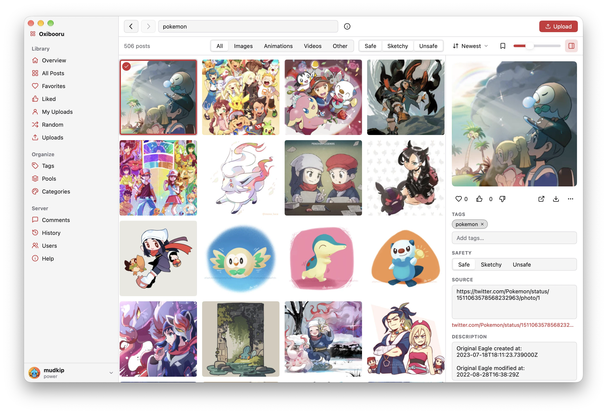

# Maibooru

A native desktop app for managing your personal media library on an [Oxibooru](https://github.com/liamw1/oxibooru) or [Szurubooru](https://github.com/rr-/szurubooru) server. Available for macOS, Windows, and Linux.



## Features

- **Browse & Search**: Scroll through your library in a responsive grid with tag autocomplete, full search syntax, sorting, filters, and saved searches.
- **Tag & Organize**: Edit tags (with implications and suggestions), safety ratings, sources, descriptions, related posts, and pools—or select multiple posts to tag, rate, pool, export, or delete in bulk.
- **Media Viewer**: View images (including animated GIF/PNG, AVIF, and JPEG XL), play videos, and open PDFs or Flash posts, complete with zoom and pan, image notes, and comments.
- **Drag-and-Drop Workflows**: Import files, folders, or links by dropping or pasting them into the window, with automatic duplicate and similar-post detection. Drag posts back out into other apps, open them in your default viewer, and keep viewed files cached locally.
- **Full Server Support**: Manage tags, categories, pools, comments, favorites, users, and edit history across multiple servers.
- **Desktop Native**: Follows your system light/dark theme, stores credentials in your OS keychain, and supports optional PIN and Touch ID (macOS) app lock.

## Install

Download the latest version from [Releases](https://github.com/mudkipme/maibooru/releases):

- **macOS**: `.dmg` (Apple Silicon & Intel)
- **Windows**: Installer (`.exe`) or portable `.zip` (x64 & ARM64)
- **Linux**: `.AppImage` (x86_64 & ARM64)

A `nightly` pre-release is also published on every push to `main`.

> **Note:** Windows builds are currently unsigned—if SmartScreen appears, choose **More info → Run anyway**. On Linux, video playback uses GStreamer, extended formats (AVIF, JPEG XL, PDF, Flash) use WebKitGTK 4.1, and saved logins require a Secret Service keyring.

## Development

Requires [Go](https://go.dev/dl/) 1.27.4 or later.

```sh
go tool mygo dev    # run the app with live rebuild
go test ./...       # run tests
go tool mygo build  # package the app for your current platform
```

## License

[MIT](LICENSE)
